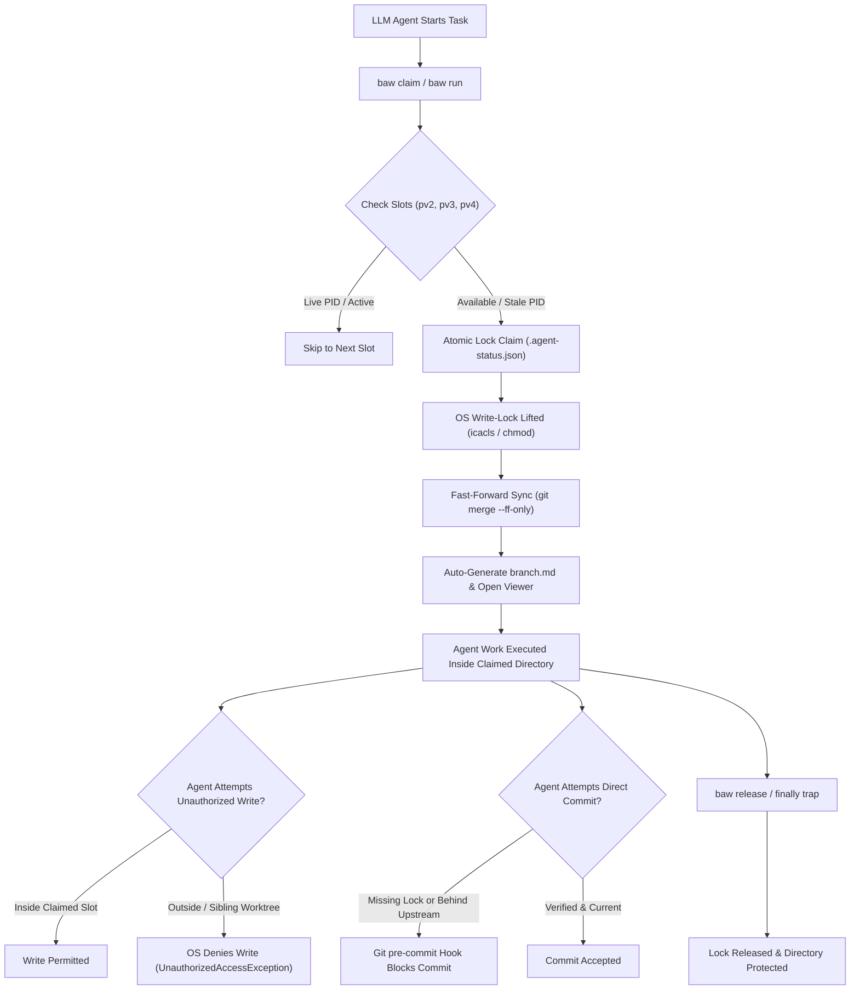

# 🌿 branch-agent-worker (`baw`)

> **Autonomous branch & worktree orchestration, atomic lock acquisition, and git synchronization for LLM coding agents (Gemini Antigravity, Claude Code, Cursor, Copilot).**

Text instructions in `AGENTS.md` frequently fail with autonomous agents: LLMs treat Markdown as advisory context, and tool-calling engines (`write_file`, `replace_in_file`) bypass shell prompts unless blocked mechanically by the **operating system** or **Git pipeline**.

`branch-agent-worker` is a modular, zero-dependency toolchain that turns any Git repository into an arbitrated multi-agent workspace with **physical disk and Git-level boundaries**.

---

## 🛡️ 3-Tier Mechanical Defense Architecture



| Layer | Intercepts | Physical Mechanism |
|---|---|---|
| **1. Workspace Scoping** | Agent file tree visibility | Sandboxes agent IDE / CLI directly inside the claimed worktree directory (`baw run -- code .`). |
| **2. Atomic Session Gate** | Rogue tool calls / multi-agent collisions | Atomic lock arbitration (`.agent-status.json`) with PID liveness tracking and TTL auto-recovery. |
| **3. Git Commit Gate** | Unauthorized / Desynced commits | Git `pre-commit` hook strictly blocks commits if `.agent-status.json` is missing or if branch is behind upstream. |

---

## ⚡ Quick Start

### 1. Installation

Run via Bun or Node.js directly from source:

```bash
cd D:/github/branch-agent-worker
bun link    # registers 'baw' globally
```

Or copy `branch-worker.ps1` directly into your repository root for a zero-dependency PowerShell setup.

### 2. Initialize in Any Git Repository

Navigate to your target project and run:

```bash
cd /path/to/my-repo
baw init --slots 3 --prefix pv
```

This creates:
- `.branch-worker.json` with branch and worktree definitions.
- `.githooks/pre-commit` and configures `git config core.hooksPath .githooks`.

### 3. Check Slot Status

```bash
baw status
```

Output:
```text
🌿 Worker Slot Registry (D:\github\my-app)

Slot      Branch        Status        PID       Agent           Task
---------------------------------------------------------------------------
pv2       preview2      AVAILABLE     -         -               -
pv3       preview3      ACTIVE        14208 ●   Antigravity     task-45
pv4       preview4      AVAILABLE     -         -               -
```

### 4. Claim a Slot for an Agent Session

```bash
baw claim --agent "Antigravity" --task "task-46" --notepad
```

1. Selects the first available slot (`pv2`).
2. Cleans up stale locks if PID terminated or TTL expired (> 2h).
3. Unlocks the OS write permissions for that directory.
4. Fast-forwards the branch with `origin/main`.
5. Writes `.agent-status.json`.
6. Generates [`branch.md`](#generated-branchmd) and opens it in Notepad.

### 5. Wrap an Agent Execution (`try/finally` Guaranteed Release)

Run your editor, IDE, or CLI agent inside the claimed worktree. When the process finishes or is killed (SIGINT/Ctrl+C), `baw` guarantees lock release:

```bash
baw run --agent "Antigravity" --task "task-46" -- code .
```

---

## 🤖 LLM Agent Integration & System Prompts

For complete autonomous agent operating instructions, see [**`AGENTS.md`**](file:///D:/github/branch-agent-worker/AGENTS.md).

### Drop-in Prompt for Any Coding Agent
Add this block directly to your agent's system prompt or project instructions:

```markdown
### Mandatory Multi-Agent Worktree Protocol
1. Before editing any files, run `baw claim --agent "<Name>" --task "<TaskId>" --notepad`
2. Open `branch.md` to see your allocated directory and staging URL.
3. Restrict all edits, tool calls, and tests strictly inside that directory.
4. When finished or interrupted, run `baw release --worktree <slot-id>`.
```

---

## ⚙️ Configuration (`.branch-worker.json`)

Place `.branch-worker.json` in your repository root to customize behavior:

```json
{
  "baseBranch": "main",
  "remote": "origin",
  "worktreeLayout": "adjacent",
  "slots": [
    {
      "id": "pv2",
      "branch": "preview2",
      "folderName": "my-app-pv2"
    },
    {
      "id": "pv3",
      "branch": "preview3",
      "folderName": "my-app-pv3"
    },
    {
      "id": "pv4",
      "branch": "preview4",
      "folderName": "my-app-pv4"
    }
  ],
  "ttlHours": 2,
  "enableOsWriteLocks": true,
  "lockTargetDir": "src",
  "previewUrlTemplate": "https://{branch}-my-app.workers.dev"
}
```

---

## 📄 Generated `branch.md`

Whenever a slot is claimed or released, `branch.md` is updated in the workspace root:

```markdown
# 🌿 Active Agent Session & Branch Allocation

| Attribute | Details |
|---|---|
| **Agent** | Antigravity |
| **Task ID** | task46-20261028 |
| **Branch** | `preview2` (`my-app-pv2`) |
| **Directory** | `D:\github\my-app-pv2` |
| **Status** | ACTIVE |
| **Timestamp** | 2026-10-28 05:15:00 |
| **PID** | 9840 |

---

### 🔗 Live Preview URL
https://preview2-my-app.workers.dev

### 🛠️ Release Command
```bash
baw release --worktree pv2
```
```

---

## 💻 CLI Command Reference

| Command | Description |
|---|---|
| `baw init [--slots 3] [--prefix pv]` | Initializes configuration and installs git hooks. |
| `baw status` | Displays live allocation status table with PID indicators. |
| `baw claim [-a <agent>] [-t <task>] [-n]` | Acquires an available worktree slot and syncs upstream. |
| `baw release -w <slot>` | Releases lock and re-locks directory write permissions. |
| `baw run [-a <agent>] [-t <task>] -- <cmd>` | Runs command scoped to claimed worktree with guaranteed release. |
| `baw hooks` | Re-installs Git safety hooks (`core.hooksPath`). |
| `baw lock-all` | Applies OS write deny rules across all worktree targets. |
| `baw unlock-all` | Removes OS write deny rules across all worktree targets. |

---

## 🧪 Testing

```bash
bun test
```

Zero external npm dependencies. Built directly on Bun and native Node APIs (`node:fs`, `node:child_process`, `node:path`, `node:util`).

---

## 📜 License

MIT © [ayeeff](https://github.com/ayeeff)
